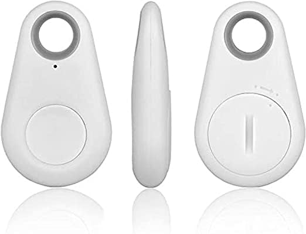

# Monqz (منقذ)

Monqz turns a small **AB Shutter3 Bluetooth camera remote** into a help button. Pressing the remote starts a repeating local alarm and displays a large alarm screen on an Android phone or tablet. An optional emergency contact can receive an SMS when the alarm starts.

> This is a personal assistance project built around a consumer camera remote. It is not a certified medical device or a guaranteed emergency-response system, and it does not call emergency services.

## How it works

The AB Shutter3 is designed to trigger a phone camera. When paired, Android exposes it as a Bluetooth input device. Depending on the phone and remote settings, its button sends a key such as `VOLUME_UP`, `CAMERA`, or `ENTER`. Monqz uses an Android AccessibilityService to capture supported key presses while another app is in the foreground and tells the monitoring service to start the alarm.

On some devices, the remote key event is not delivered to the app while the screen is off. Monqz also watches media-volume changes while a silent media stream is active. If it detects a volume increase, it starts the alarm. A foreground service keeps monitoring active, tracks the input-device and BLE connection states separately, and retries BLE connection after a drop.

The alarm is posted as a high-importance notification separate from the persistent monitoring notification. When the device is locked or the display is off, Android can open the full-screen alarm activity over the lock screen. When the device is unlocked, Android may show a persistent heads-up notification instead; tapping the notification body opens the red alarm screen. The user can stop the sound from either the alarm screen or the notification.

## Tested devices and setup

| Device | Verification |
| --- | --- |
| **Samsung Galaxy Tab A7 (10.4-inch LTE), model SM-T505N**, Android 12 / API 31 | Installed and used in landscape. Verified the tablet layout, alarm screen, and stop control. After enabling the AccessibilityService and notification settings, the user confirmed that the red alarm screen appeared with the tablet locked. [Samsung support page for this model](https://www.samsung.com/za/support/model/SM-T505NZADXFA/) |
| **POCO X3 GT** | Monitored the remote as an input device and checked BLE connection state during an approximately one-minute screen-off run. |
| **AB Shutter3 Bluetooth Remote Shutter** | The small one-button camera remote used for testing. It appears under the name `AB Shutter3` when paired and acts as an input device that can send a volume-up key. The photographed manual says to hold the button for about three seconds to turn it on and enter pairing mode; it specifies a CR2032 coin-cell battery. |

Testing on these devices does not guarantee the same behavior on every Android version or manufacturer skin. Background-service and full-screen-notification rules vary by device and system settings.

## Hardware used

Monqz was developed and tested with the **AB Shutter3 Bluetooth camera remote** shown below. It is a small, battery-powered Bluetooth camera shutter that pairs with Android as an input device. In this project, its button is used as the patient's help button.



Product details and seller listing: [AB Shutter3 Bluetooth remote on Amazon.eg](https://www.amazon.eg/dp/B0BXQP9815).

The product image is included for identification; the model and behavior can vary between sellers and hardware revisions.

## Requirements

- Android 8.0 (API 26) or later.
- Android Studio, JDK 17, and Android SDK 35 to build.
- An AB Shutter3 remote paired with the phone or tablet through Bluetooth.

## Install and configure

1. Open the project in Android Studio, or install a debug APK built from this project.
2. Launch Monqz and grant the requested Bluetooth / nearby-device and notification permissions.
3. Enable **استقبال زر ريموت المساعدة** (“Receive help remote button”) in Android Accessibility settings. Capturing the remote's system-wide key events requires this service.
4. Pair `AB Shutter3` in Android Bluetooth settings.
5. Return to Monqz and start monitoring. Keep the persistent monitoring notification enabled.
6. Use **تجربة الإنذار** (“Test alarm”) first, then test the physical remote with the screen both on and locked.
7. To enable caregiver SMS, enter an international phone number, save it, and grant SMS permission. This is optional.

If the red screen does not appear while locked, check that Monqz notifications are enabled and that the **Help alarm** notification channel has high importance. On Android 14 and later, Android may also require permission for Monqz to use full-screen notifications.

## Build

In Android Studio, choose **Build > Make Project**, or run:

```bash
./gradlew assembleDebug
```

On Windows:

```powershell
.\gradlew.bat assembleDebug
```

The debug APK is written to `app/build/outputs/apk/debug/app-debug.apk`. Build outputs, APKs, and local signing keys are excluded from this repository by `.gitignore`.

## Project structure

- `MainActivity.kt`: responsive phone/tablet interface, monitoring status, alarm settings, and caregiver number.
- `ShutterKeyService.kt`: captures remote key events through Android Accessibility.
- `MonitorService.kt`: foreground monitoring service, repeating alarm, screen-off volume path, notifications, BLE monitoring, and reconnect attempts.
- `AlarmActivity.kt`: red alarm screen and large stop control, adapted for phone and tablet layouts.
- `AlarmState.kt`: monitoring, alarm, and local preference state.
- `BootReceiver.kt`: resumes monitoring after reboot where Android allows it.
- `SmsStatusReceiver.kt`: updates caregiver SMS delivery status.

## Known behavior and limitations

- **Bluetooth:** Monqz retries BLE connection after disconnects and also checks whether the remote is visible as an input device. It cannot force Android or the remote firmware to keep the radio connected indefinitely. A depleted remote battery, distance, or radio interference may prevent a press from reaching the app, including the first press after an interruption.
- **Screen-off input:** Android may not identify which device sent a volume-up event. The phone's side volume button or another remote can trigger the alarm just like the AB Shutter3. If SMS is configured, an unintended trigger may also send a message.
- **Battery use:** Background monitoring uses a foreground service, a partial CPU wake lock, and a silent media stream. This uses additional battery. Review the battery settings in Monqz and on the device.
- **Reboot:** On Android 15, system restrictions prevent this foreground-service type from starting automatically directly from the boot event. Open Monqz after a reboot to resume saved monitoring.
- **SMS:** Sending requires a saved number, SMS permission, a capable SIM, and network service. Carrier charges may apply. The local alarm works without SMS setup.
- **Lock screen:** The alarm screen does not dismiss or bypass the device passcode.

## Privacy

The alarm runs locally on the device. The app does not upload data to a server. An SMS is sent only if a caregiver number is configured and SMS permission is granted. The number is stored in the app's local preferences.

## License

No license is included yet. Add a license file before reusing or distributing this project under an open-source license.
